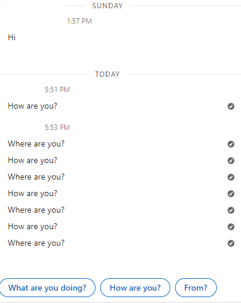
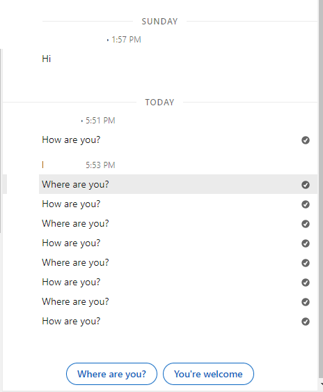

LinkedIn messaging shows a row of suggested replies under each conversation, generated from the recent messages, so you can answer with one click. I was talking to a stranger on LinkedIn and noticed how poor those suggestions were. I've left the stranger unnamed and hidden my own name in the screenshots.

The conversation had turned into "How are you?" and "Where are you?" repeated over and over. The suggestions offered were "What are you doing?", "How are you?" and "From?", so two of the three were just more questions of the same kind.

A few messages later the suggestions were "Where are you?", which is the message just above it, and "You're welcome", which doesn't answer anything that was said.

The problem is that the suggestions are circular. When a conversation is repetitive, the model echoes the input back instead of adding anything, and clicking a suggestion would only keep the loop going. Suggested replies work for "Thanks!" or "Sounds good" on a normal message. Once a conversation goes off the rails, they're no help at all.
