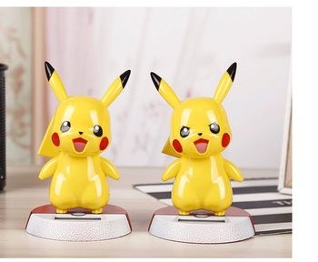
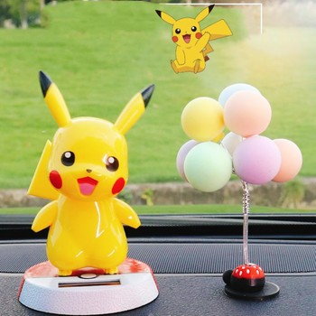

If you like Pokémon and want something cheerful on your desk, a solar-powered Pikachu bobblehead is hard to beat. I bought mine in Chinatown for $12.99 years ago. When I wrote this in 2023, the same kind of toy was selling on AliExpress for about $5 to $10.

## The one I bought in Chinatown

About six years before writing this, I was in Chinatown with friends and found a small shop selling anime figures and toys. On the shelf was a bright yellow Pikachu bobblehead with a small solar panel in its Poké Ball base. Put it in the light and its head bobs. At $12.99 it felt like a steal, and I bought it.

It has made me smile ever since. Pikachu bobbles away on energy from whatever light it sits under, a small reminder to find joy in little things.

## Getting one for less on AliExpress

Similar solar Pikachu bobbleheads are listed on AliExpress for much less than I paid. Prices are lower mainly because many sellers are manufacturers or wholesalers in China selling directly to buyers online, with no import markup from a local shop and no storefront rent.

The trade-off is shipping time. Delivery usually takes two to three weeks, which I think is worth it for the savings.

## Is the quality any good?

In my experience, yes, as long as you shop carefully:

- Read the reviews and look at photos posted by buyers, not just the seller's product shots. Buyer photos show what actually arrives.
- Prefer sellers with high ratings and many positive reviews.
- Pay with a method that has buyer protection. AliExpress has its own buyer protection for items that don't arrive or don't match the listing, and PayPal adds another layer where it's offered at checkout.

I was hesitant to order from sellers in China at first. After a few small purchases went fine, I've kept buying there. The range of odd, cheap products is huge, and the items I've received have matched their descriptions.

## Where to get one

Don't overpay for Pokémon knick-knacks at a gift shop. These are the two listings I found. Both links are AliExpress affiliate links, and prices may have changed since 2023.

https://s.click.aliexpress.com/e/_EzsfG7D

or

https://s.click.aliexpress.com/e/_mKsNLUS
