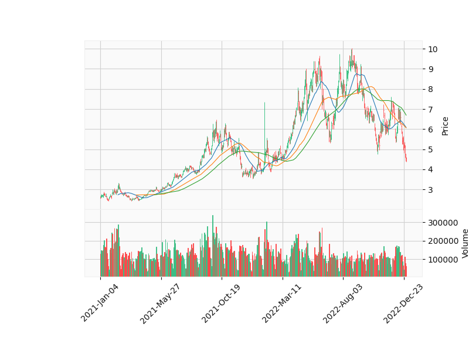

I wanted a quick read on where natural gas prices had been before estimating what a Canadian gas producer, Birchcliff Energy (BIR.TO), might earn. This post pulls two years of NYMEX Henry Hub futures (`NG=F` on Yahoo Finance), averages them by quarter, and plots them with moving averages.

## What moves natural gas prices

North American gas prices are set mostly by weather (heating demand in winter, power-burn for air conditioning in summer), storage levels compared with the five-year average, which the EIA reports every Thursday, production, and LNG export demand. In 2022, Russia's invasion of Ukraine pulled European buyers toward US LNG and sent Henry Hub to its highest levels in over a decade. That is the spike in the chart below.

Gas producers are cyclical stocks: their earnings track the commodity price, so a quarter of $8 gas and a quarter of $3 gas look like two different companies.

## Quarterly and rolling averages

A moving average smooths daily noise so the trend is easier to see. Price above a rising moving average is usually read as an uptrend, and below a falling one as a downtrend. For estimating a producer's quarterly revenue, though, the more useful number is the plain average price over each calendar quarter, since that is roughly what the company realised.

```bash
pip install yfinance mplfinance six
```

`mplfinance` (last released as 0.12.10b0 in 2023) imports `six` without declaring it as a dependency, so install it explicitly.

```python
import mplfinance as mpf
import yfinance as yf

# Front-month Henry Hub natural gas futures, two years of daily bars
nat_gas = yf.download(
    "NG=F", start="2021-01-01", end="2023-01-01",
    progress=False, multi_level_index=False,
)

# Average close for each calendar quarter ("QE" = quarter end)
quarterly = nat_gas["Close"].resample("QE").mean().rename("avg_close")
print(quarterly.round(2))

# Rolling ~3-month average (about 63 trading days)
nat_gas["MA_63"] = nat_gas["Close"].rolling(63).mean()
print(nat_gas[["Close", "MA_63"]].tail())

# OHLC chart with 30/60/90-day moving averages and volume
mpf.plot(
    nat_gas, type="ohlc", mav=(30, 60, 90), volume=True,
    style="yahoo", savefig="ng.png",
)
```

The quarterly averages (USD per MMBtu, front-month close):

```text
Date
2021-03-31    2.72
2021-06-30    2.98
2021-09-30    4.32
2021-12-31    4.84
2022-03-31    4.59
2022-06-30    7.50
2022-09-30    7.95
2022-12-31    6.09
Freq: QE-DEC, Name: avg_close, dtype: float64
```



A few notes on the code:

- `multi_level_index=False` keeps columns flat (`Open`, `High`, `Low`, `Close`, `Volume`). Recent yfinance versions otherwise return a `('Close', 'NG=F')` MultiIndex, which mplfinance can't read.
- `resample("QE")` groups by calendar quarter. Older pandas used `"Q"`, which pandas 2.2 deprecated in favour of `"QE"`.
- `mav=(30, 60, 90)` in mplfinance counts rows (trading days), not calendar days, so the 60-row line is roughly a three-month average.
- `NG=F` is a continuous front-month series. It jumps at each contract roll, so treat it as an approximation of spot, not a tradeable price history.

## Back-of-envelope numbers for Birchcliff

These are my own rough estimates from around the start of 2023, in CAD millions, when gas was trading near $4.50. My first guess for Q4 2022 was about $475M of revenue and $260M of profit, but after reading the investor presentation I settled on about $360M of revenue and $160M of profit.

```python
quarterly_profit = 160        # my Q4 2022 estimate
shares_outstanding = 266.05   # millions of shares
quarterly_dividend = shares_outstanding * 0.20  # $0.80/yr base dividend, paid quarterly
free_cash = quarterly_profit - quarterly_dividend
total_debt = 138.5            # reported total debt at December 31, 2022

print(f"dividend: {quarterly_dividend:.1f}M, left over: {free_cash:.1f}M")
print(f"debt after one quarter of paydown: {total_debt - free_cash:.1f}M")
```

```text
dividend: 53.2M, left over: 106.8M
debt after one quarter of paydown: 31.7M
```

My original notes used $176M of debt. Birchcliff reported $186.1M at September 30, 2022 and $138.5M at year-end. Either way, at those gas prices the dividend looked well covered and the debt could be cleared within a few quarters. The main risk was falling gas prices, but with Russian supply leaving the market I doubted it would get that bad.

**Update:** it did get that bad. The `NG=F` front-month close averaged about $2.67 in 2023 and was below $3 on most trading days. Birchcliff cut its 2024 base dividend to $0.40 a year ($0.10 a quarter) to protect the balance sheet, then cut it again to $0.12 a year for 2025. The sensitivity in the script above is the lesson: the dividend was covered at $4.50 gas, not at $2.50.

## Plotting libraries

mplfinance is the quickest way to get OHLC or candlestick charts with moving averages and a volume panel from a pandas DataFrame. For interactive charts, Plotly's `go.Candlestick` and Bokeh both work. Plain Matplotlib or seaborn are fine for line plots of the averages.

## Longer-term demand

Gas demand for power generation has grown as coal plants retire, since gas plants can ramp up and down to back up wind and solar. Over the long run, how fast renewables, storage and electrification grow will matter more to gas producers than any moving average.

## Further reading

- [yfinance documentation](https://ranaroussi.github.io/yfinance/)
- [pandas time series and resampling](https://pandas.pydata.org/docs/user_guide/timeseries.html)
- [mplfinance on GitHub](https://github.com/matplotlib/mplfinance)
- [EIA weekly natural gas update](https://www.eia.gov/naturalgas/weekly/)
