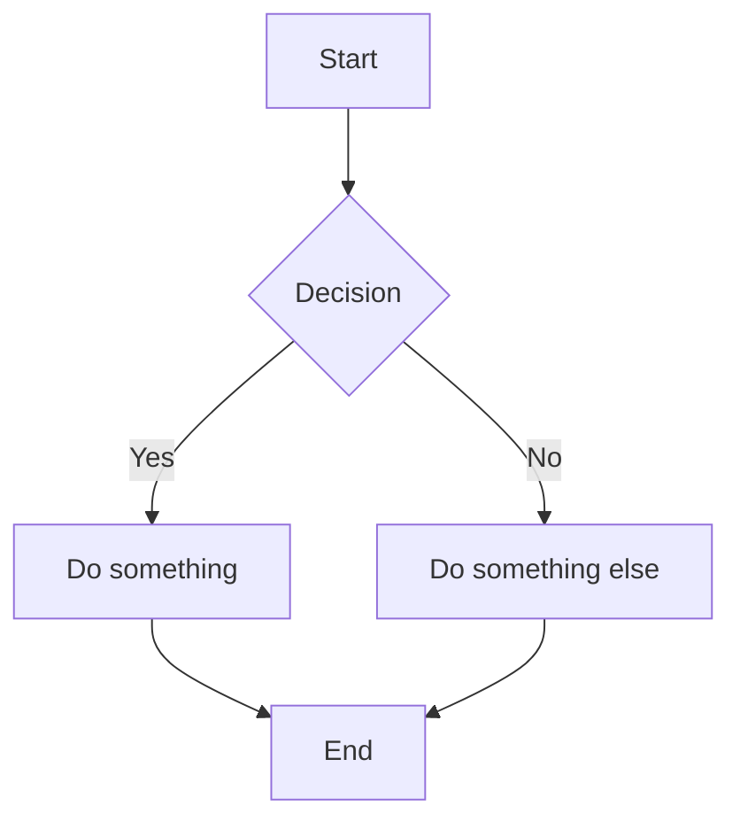
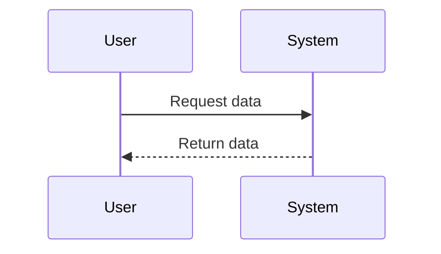
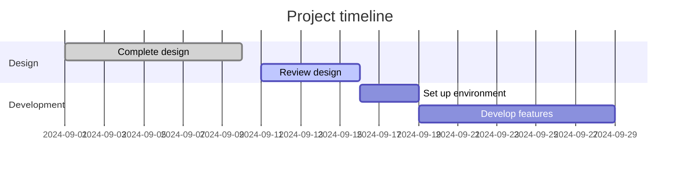
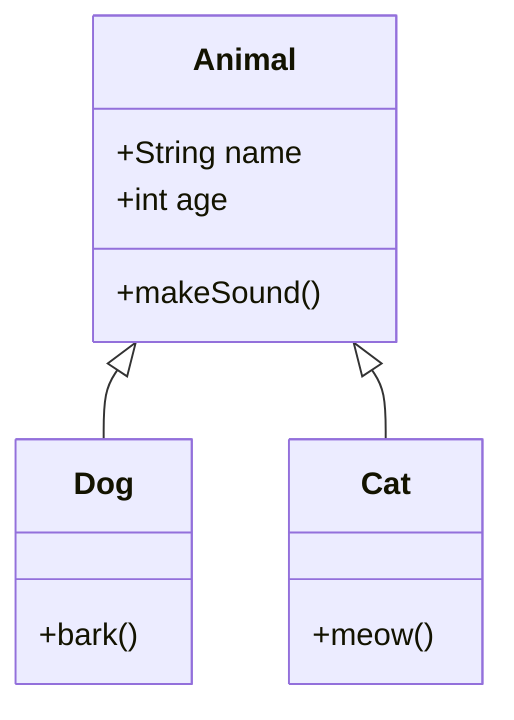
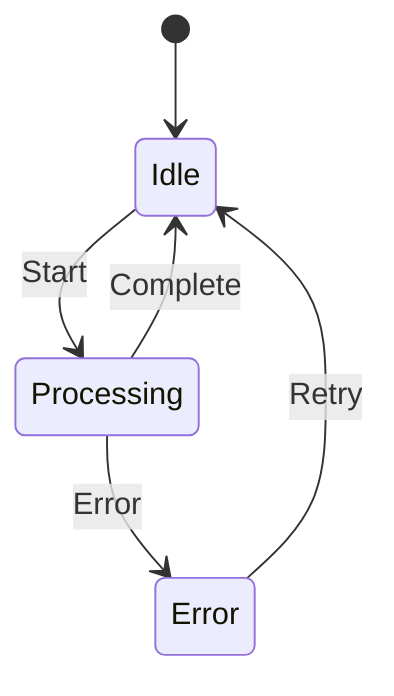
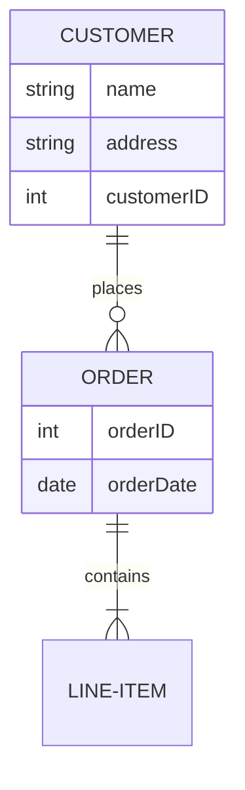
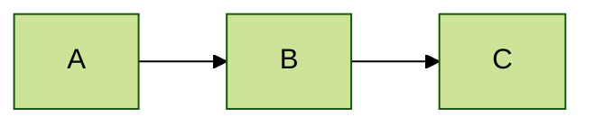

[Mermaid](https://mermaid.js.org/) is a JavaScript library that turns a short text description into an SVG diagram. Because the source is plain text, diagrams live next to your code, show up in diffs, and get reviewed like anything else. GitHub and GitLab render `mermaid` code blocks in Markdown natively, and most documentation tools have a plugin (this blog renders them with `astro-mermaid`, so every example below is drawn live from its source).

## Flowcharts

Nodes are declared inline; `-->` draws an arrow and `|text|` labels it. `TD` means top-down (`LR` is left-to-right).



Bracket shape sets node shape: `[ ]` rectangle, `{ }` diamond, `( )` rounded. `graph` still works as an alias for `flowchart`.

## Sequence diagrams

Good for request/response flows between services. `->>` is a solid arrow, `-->>` a dashed reply.



## Gantt charts

Each task has an optional status (`done`, `active`, `crit`), an ID, a start (a date or `after <id>`), and an end date or duration.



## Class diagrams

`+` marks public members; `<|--` is inheritance.



## State diagrams

`[*]` is the start (or end) state.



## Entity relationship diagrams

The symbols on each side of `--` give cardinality: `||` exactly one, `o{` zero or more, `|{` one or more.



## Themes and configuration

Built-in themes are `default`, `neutral`, `dark`, `forest` and `base` (the one to customise with `themeVariables`). Set per diagram with a YAML frontmatter `config` block:



Older examples use `%%{init: {"theme": "forest"}}%%` directives instead. Directives have been deprecated since Mermaid v10.5.0 in favour of frontmatter config.

## Links and security

Flowchart nodes can link somewhere with `click`:

```text
flowchart LR
    A[Docs] --> B[Live editor]
    click B "https://mermaid.live" "Open the live editor"
```

Clicks only work if the page initialises Mermaid with `securityLevel` set to `loose` or `antiscript`. The default, `strict`, encodes HTML in labels and disables click handlers, which is what you want when rendering diagrams written by untrusted users. There's also `sandbox`, which renders each diagram inside a sandboxed iframe.

## Rendering Mermaid yourself

On a plain HTML page, load the ES module from a CDN and put diagram source inside `<pre class="mermaid">`:

```html
<pre class="mermaid">
flowchart LR
    A --> B
</pre>

<script type="module">
  import mermaid from "https://cdn.jsdelivr.net/npm/mermaid@12/dist/mermaid.esm.min.mjs";
  mermaid.initialize({ startOnLoad: true });
</script>
```

To produce image files (for slides, PDFs, or anywhere without JavaScript), use the official CLI, `mmdc`:

```bash
npx -p @mermaid-js/mermaid-cli mmdc -i diagram.mmd -o diagram.svg
```

It also accepts `.png` and `.pdf` output.

For quick experiments, the free [Mermaid Live Editor](https://mermaid.live/) renders as you type and gives you a shareable link. [Mermaid Chart](https://www.mermaidchart.com/landing/?utm_source=UGC&utm_medium=UGC&utm_campaign=0023) is the hosted, commercial editor from the team behind Mermaid; see the [Mermaid Chart Guide](https://www.mermaidchart.com/) for more examples.

## Gotchas

- Syntax errors fail the whole diagram. Paste it into the live editor to see which line is wrong.
- Words like `end` in lowercase break flowcharts as node text; capitalise at least one letter (`End`).
- Large graphs lay out poorly. Split them, or switch direction (`LR` vs `TD`).
- Renderers pin different Mermaid versions, so newer diagram types may work in the live editor but not on GitHub or in your docs tool yet.

To generate images on the web, check out this [Mermaid Chart Tool](https://singular-catharanthus-5a60b5a247c5.herokuapp.com/b?y=49ii4eh26or66p1g70om4opl68pj4dhg65h36p366kr68cp25gh748hq49k78t3gect2ubrnetrisrb5e9mm2qb4cdk62sjk5phmur9fdhgmsp39dpjiufrlehmlusrfelp66p9tal3k6n3l60o34djlehmlurb5chknar9tal3k6n3l60o34djlehmluor1dlo62qb7douj0c1i6ch0====). Please note that this is an affiliate link, and using it supports us at no additional cost to you.

## Further reading

- [Mermaid documentation](https://mermaid.js.org/intro/)
- [Syntax reference for each diagram type](https://mermaid.js.org/intro/syntax-reference.html)
- [Mermaid configuration and themes](https://mermaid.js.org/config/theming.html)
