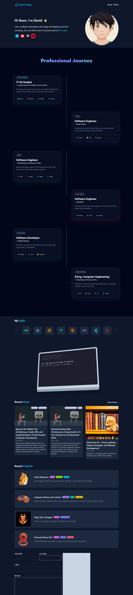

This site just had its biggest change since it moved to Astro. There are three parts to it:

1. **A new homepage.** The landing page is now a single three.js scene: a night harbour city made of data. Scrolling flies one camera through a district for each part of my career, and ends in a sky with one star for every post on this blog.
2. **A new blog.** The posts moved from plain Astro pages to [Starlight](https://starlight.astro.build/), with search, a sidebar, topic pages and a theme that matches the homepage. Every post kept its exact URL.
3. **The old homepage is still here.** It lives at [/old_site](/old_site/), because its animations were worth keeping.

## Before: the classic homepage

The previous homepage was a set of React islands styled with Tailwind and animated with GSAP: a hero with an avatar, a scroll-triggered career timeline, a skills strip, an animated laptop typing out a terminal, recent posts and projects.

<video controls muted loop playsinline preload="metadata" width="1280" height="720" poster="/assets/posts/threejs-redesign/old-homepage-poster.webp" style="width:100%;height:auto;border-radius:4px">
  <source src="/assets/posts/threejs-redesign/old-homepage.mp4" type="video/mp4" />
  The classic homepage scrolling from the hero through the timeline, skills, laptop animation, recent posts and projects.
</video>

Here is the whole page in one capture. Its sections only animate in while they are on screen, so this was stitched together one viewport at a time ([open full size](/assets/posts/threejs-redesign/old-homepage-full.webp)):

<div style="max-height:34rem;overflow:auto;border:1px solid var(--sl-color-hairline);border-radius:4px">
  
</div>

## After: a city built from my work

<video controls muted loop playsinline preload="metadata" width="1280" height="720" poster="/assets/posts/threejs-redesign/new-homepage-poster.webp" style="width:100%;height:auto;border-radius:4px">
  <source src="/assets/posts/threejs-redesign/new-homepage.mp4" type="video/mp4" />
  The new homepage scrolling through each chapter of the three.js city.
</video>

Each chapter is a district, and the camera travels between them on one continuous path:

| Chapter | What you see |
| --- | --- |
| 00 Hello | The harbour: water with light reflections, a moon, drifting "data rain" |
| 01 Foundations | A blueprint grid and wireframe buildings that draw themselves in (UVic and my first startup) |
| 02 Marketplace | Streets of moving car lights (carSHAiR) |
| 03 Construction data | A tower built floor by floor by a rising cut plane, a crane, and data bricks stacking up (Yellowsheet) |
| 04 Claims AI | Claim documents fanning open with lines to extracted fields (Royal Claims) |
| 05 Public service | A civic hall in warm light with falling maple leaves (Canada School of Public Service) |
| 06 Writing & tools | A constellation with one star per post, grouped by topic |
| 07 Contact | The whole city from above, with skills and contact links |

The text stays ordinary HTML on top of a fixed canvas, so it is readable, selectable and accessible. The scene is decoration that follows along.

### How the scene is built

Nothing in the city is a model file. Every building, crane, column and star is generated at runtime, which keeps the page small: three.js plus the scene is about 156 KB gzipped, and it loads after the text is already on screen.

- **One InstancedMesh for the whole skyline.** Lit windows are drawn in the fragment shader from each building's size, so hundreds of towers cost one draw call.
- **Animation lives in shaders.** The rain, the car lights and the twinkling stars move on the GPU from a single `uTime` uniform, with no per-frame JavaScript loops over particles.
- **Scroll position becomes one number.** The page measures each chapter's position and turns the scroll offset into a continuous chapter index. The camera eases toward that point on a Catmull-Rom curve through eight keyframes.

```ts
// main.ts: turn the scroll position into a continuous chapter index for the camera
for (let i = n - 1; i >= 0; i--) {
  if (y >= anchors[i]) {
    if (i === n - 1) return i;
    const next = Math.min(anchors[i + 1], maxY);
    return i + Math.min(1, (y - anchors[i]) / Math.max(1, next - anchors[i]));
  }
}
```

- **The tower uses a cut plane.** The whole tower exists from the first frame. A height uniform discards every fragment above the line, a yellow cap sits at the cut, and scaffolding is drawn only above it. As you scroll, the line rises and the building "constructs" itself.
- **The constellation is real data.** At build time every post gets a topic, from its folder first and then from keywords in its tags and title. The homepage receives one `[topic, age]` pair per post. Newer posts are brighter, and hovering a topic lights up its stars and lists its latest posts.
- **The details are kept restrained.** There is a soft bloom pass, a film-grain overlay, and procedural SVG silhouettes pinned to the bottom of the screen that fade between chapters.

It also respects the device it's running on:

- Pixel density is capped and particle counts scale with the viewport.
- Rendering pauses when the tab is hidden.
- With `prefers-reduced-motion`, the scene renders one still frame per chapter instead of animating.
- If WebGL isn't available, the page falls back to a gradient, and every word of content is still there.

The approach came from Meng To's [DesignCode walkthrough on building three.js sites with Claude](https://www.youtube.com/watch?v=G-F5Qvy-7KM) and his open-source studies. The ideas I took were:

- Build everything procedurally.
- Drive one camera path from scroll.
- Depth comes from layering.
- Treat verification (desktop, phone, console, a full scroll pass) as part of the job.

## The blog moved to Starlight

The posts used to be Markdown pages under `src/pages/posts`, each pointing at a custom layout. They now live in a Starlight content collection, with the same header, sidebar and search on every page, recoloured to match the homepage.

<video controls muted loop playsinline preload="metadata" width="1280" height="720" poster="/assets/posts/threejs-redesign/new-blog-post-poster.webp" style="width:100%;height:auto;border-radius:4px">
  <source src="/assets/posts/threejs-redesign/new-blog-post.mp4" type="video/mp4" />
  A blog post on the new Starlight layout.
</video>

The one rule for the move was that no post URL could change. Starlight normally lowercases and slugifies file names, which would have turned `/posts/tech/2023/Rust's_Error_Handling…` into something new and broken every existing link. A custom `generateId` keeps the path exactly as it is:

```ts
// content.config.ts
const keepPath = ({ entry }: { entry: string }) => entry.replace(/\.(md|mdx)$/i, '').replace(/\/index$/, '');

export const collections = {
  docs: defineCollection({
    loader: docsLoader({ generateId: keepPath }),
    schema: docsSchema({ extend: z.object({ pubDate: optionalDate, tags: tagList, imgSrc: z.string().optional() }) }),
  }),
};
```

I compared the list of post URLs before and after the move, and all of them still resolve.

Other changes on the blog side:

- **[Topics](/topics/).** The same twelve clusters as the homepage constellation now have their own pages, alongside the existing tag pages.
- **A sidebar that scales.** Listing every post on every page would have meant hundreds of links per page. Instead the sidebar shows navigation, the topics with counts, and more posts from the topic you're reading.
- **Search.** Starlight's built-in Pagefind search covers every post.
- **Post headers.** Each post shows its date, topic, tags and cover image. Older and newer post links sit at the bottom.
- **One title per post.** Most posts started with a `# Title` heading that would now duplicate Starlight's title, so a small remark plugin drops a leading H1 from posts.

## Bugs found along the way

Moving everything around turned up two things that had quietly broken, most likely during the upgrade to Astro 7:

- **The `/posts` list and every tag page were empty.** They collected posts with the glob `*.md(x)?`, which no longer matched anything. They now read from the content collection.
- **`/rss.xml` wasn't being generated.** The endpoint still exported a lowercase `get` handler, which Astro 7 no longer runs. It's now `GET`, and the feed includes every post again.

## Where things are

- [Home](/) — the three.js city
- [Blog](/posts/) and [Topics](/topics/) — every post, newest first or by subject
- [Classic site](/old_site/) — the previous homepage, unchanged
- [Source](https://github.com/FriendlyUser/astro-tech-blog)
