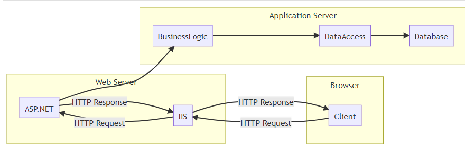

ASP.NET Core is Microsoft's cross-platform framework for building web apps and HTTP APIs in C#.
This post uses its MVC (Model-View-Controller) pattern: controllers handle requests, models hold
data, and Razor views (`.cshtml`) render HTML. You'll create a project, add an action that returns
text, then render a list of objects as an HTML table.

Older .NET Framework technologies such as ASP.NET Web Forms aren't part of ASP.NET Core. For new
projects, the options are MVC, Razor Pages, Blazor, and Web API / minimal APIs.

## Create the project

With the .NET SDK installed, create an MVC app from the command line:

```bash
dotnet new mvc -n HelloMvc
cd HelloMvc
dotnet run
```

In Visual Studio the equivalent is **File > New > Project**, then the
**ASP.NET Core Web App (Model-View-Controller)** template. `dotnet run` prints the local URL
(something like `http://localhost:5xxx`); open it to see the default home page.

The template sets up conventional routing in `Program.cs` with the pattern
`{controller=Home}/{action=Index}/{id?}`, so a request to `/Home/HelloWorld` calls the
`HelloWorld` method on `HomeController`.

## Add an action

Open `Controllers/HomeController.cs` and add a method:

```csharp
public IActionResult HelloWorld()
{
    return Content("Hello World!");
}
```

`Content` returns a plain-text response. Browse to `/Home/HelloWorld` and you'll see
"Hello World!".

To link to it from the home page, open `Views/Home/Index.cshtml` and add this inside the
`<div class="text-center">` element:

```razor
<a asp-controller="Home" asp-action="HelloWorld">Say Hello</a>
```

`asp-controller` and `asp-action` are tag helpers (enabled for every view by
`Views/_ViewImports.cshtml`). They render `href="/Home/HelloWorld"` from the routing table, so the
link stays correct if you change the route pattern later.

## Render a table from a model

Add a model class in `Models/Student.cs`:

```csharp
namespace HelloMvc.Models;

public class Student
{
    public string FirstName { get; set; } = "";
    public string LastName { get; set; } = "";
    public int Grade { get; set; }
}
```

The `= ""` initialisers avoid nullable-reference warnings, which the template enables by default.

Add a controller in `Controllers/TableController.cs` that passes a list of students to its view:

```csharp
using Microsoft.AspNetCore.Mvc;
using HelloMvc.Models;

namespace HelloMvc.Controllers;

public class TableController : Controller
{
    public IActionResult Index()
    {
        var students = new List<Student>
        {
            new() { FirstName = "John", LastName = "Doe", Grade = 80 },
            new() { FirstName = "Jane", LastName = "Smith", Grade = 90 },
            new() { FirstName = "Bob", LastName = "Jones", Grade = 75 },
        };

        return View(students);
    }
}
```

`View(students)` with no view name looks for `Views/Table/Index.cshtml` (the controller name
without the `Controller` suffix, then the action name). Create that file:

```razor
@model List<Student>

<table class="table">
    <thead>
        <tr>
            <th>First Name</th>
            <th>Last Name</th>
            <th>Grade</th>
        </tr>
    </thead>
    <tbody>
        @foreach (var student in Model)
        {
            <tr>
                <td>@student.FirstName</td>
                <td>@student.LastName</td>
                <td>@student.Grade</td>
            </tr>
        }
    </tbody>
</table>
```

`@model` declares the view's model type (`HelloMvc.Models` is already imported in
`_ViewImports.cshtml`), and `Model` is the list the controller passed in. Razor HTML-encodes
`@student.FirstName` and the other values, so user data can't inject markup. The `table` class
comes from the Bootstrap stylesheet the template includes.

Run the app and browse to `/Table` to see the three rows. In a real app the list would come from
a database (for example through Entity Framework Core) rather than being hard-coded in the action.

## Structuring a project

MVC already separates request handling (controllers), data (models) and markup (views). As a
project grows, a common next step is to split it into layers:

- **Presentation**: controllers and views (the MVC project itself).
- **Business logic**: services that hold the application's rules, injected into controllers
  through ASP.NET Core's built-in dependency injection.
- **Data access**: an EF Core `DbContext` or repositories that talk to the database.

These are often separate class-library projects referenced by the web project.



The diagram shows IIS in front of the app. With ASP.NET Core, the app itself runs on the Kestrel
web server; IIS (on Windows) or Nginx (on Linux) is an optional reverse proxy in front of it.

A few habits that pay off regardless of structure:

- Keep connection strings and settings in `appsettings.json` (and secrets in user secrets or
  environment variables), not in code.
- Manage dependencies with NuGet and keep the project in source control.
- Use consistent names: `XController` for controllers, one view folder per controller.

## Further reading

- [Get started with ASP.NET Core MVC](https://learn.microsoft.com/en-us/aspnet/core/tutorials/first-mvc-app/start-mvc)
- [Overview of ASP.NET Core MVC](https://learn.microsoft.com/en-us/aspnet/core/mvc/overview)
- [Handle requests with controllers](https://learn.microsoft.com/en-us/aspnet/core/mvc/controllers/actions)
