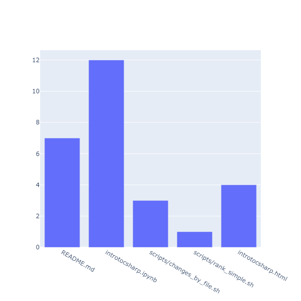

:::caution
Microsoft deprecated the Polyglot Notebooks VS Code extension on March 27, 2026 and .NET Interactive on April 24, 2026; the [dotnet/interactive](https://github.com/dotnet/interactive) repository is now archived. The [announcement](https://github.com/dotnet/interactive/issues/4163) points C# users to file-based apps (`dotnet run app.cs`) and users of other languages to the VS Code Jupyter extension with a Jupyter kernel.
:::

Polyglot Notebooks are a great way to do data science in .NET. You can use several languages in one notebook and pass variables between them. My preference is the VS Code extension (formerly .NET Interactive Notebooks).

## Reading a CSV in C#

Using the data from [How to rank software engineers using Bash](https://towardsdev.com/how-to-rank-software-engineers-using-bash-c8b1bd8885fb), this C# cell reads a CSV of change counts per file into two lists:

```csharp
#r "nuget: CsvHelper"

using System.Globalization;
using System.IO;
using CsvHelper;

List<dynamic> records;
using (var reader = new StreamReader("data/changes_by_file.csv"))
using (var csv = new CsvReader(reader, CultureInfo.InvariantCulture))
{
    records = csv.GetRecords<dynamic>().ToList();
}

// Each dynamic record exposes the CSV headers as properties (values are strings)
var countsList = records.Select(r => r.Count).ToList();
var fileList = records.Select(r => r.File).ToList();
```

CsvHelper's dynamic records turn each row into an object whose properties are the header names, so the CSV needs `Count` and `File` columns.

## Charting it in F#

`#!share` copies a variable from another kernel into the current one. This F# cell pulls in both lists and draws a column chart with Plotly.NET:

```fsharp
#r "nuget: Plotly.NET.Interactive"
#!share --from csharp countsList
#!share --from csharp fileList

open Plotly.NET

let counts = countsList |> Seq.cast<string> |> Seq.map System.Double.Parse |> List.ofSeq
let files = fileList |> Seq.cast<string> |> List.ofSeq

Chart.Column(values = counts, Keys = files)
```

The lists arrive as collections of `object`, so `Seq.cast<string>` restores the type before the counts are parsed into numbers. `Plotly.NET.Interactive` makes the chart render inline as the cell output.



## Verdict

Polyglot Notebooks can be fairly good for data science. I don't recommend using Plotly.NET from C#; F# is the better fit for this kind of work.

More content like this is in my book on Amazon KDP.

[](https://www.amazon.com/dp/B0BY18F7HB)
