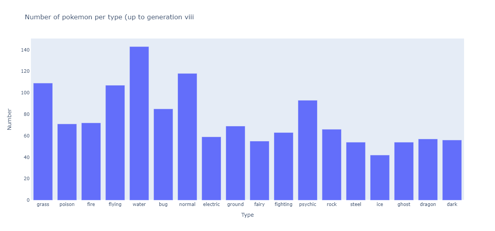

:::caution
Microsoft deprecated the Polyglot Notebooks VS Code extension on 27 March 2026 and .NET Interactive on 24 April 2026, and the [dotnet/interactive](https://github.com/dotnet/interactive) repository is now archived. For C#, Microsoft points to [file-based apps](https://github.com/dotnet/interactive/issues/4163) instead. The C# below also runs as a .NET 10 file-based app: replace the `#r` lines with `#:package Plotly.NET@6.0.0` and write each chart to a file with `File.WriteAllText("chart.html", GenericChart.toChartHTML(chart))` instead of calling `display`.
:::

This notebook does some quick analytics on the Pokémon data I scraped for my Flutter Pokédex app. For the first post on scraping the data, see

https://friendlyuser.github.io/posts/tech/flutter/scrapping_data_for_pokedex/

The data is a JSON array with one object per Pokémon (916 entries, up to Generation VIII). Each object has a name, IDs, an image URL and a list of types, and each type carries the generation it was introduced in.

## Load the JSON

Download the file with `HttpClient` and deserialize it into C# classes whose property names match the JSON keys. Notebook cells support top-level `await`, so there's no need to block on `.Result`.

```csharp
using System.Net.Http;
using System.Text.Json;

public class PokemonV2Type
{
    public string name { get; set; }
    public int generation_id { get; set; }
    public int id { get; set; }
}

public class PokemonV2Pokemontype
{
    public PokemonV2Type pokemon_v2_type { get; set; }
}

public class Pokemon
{
    public string name { get; set; }
    public int id { get; set; }
    public int pokemon_species_id { get; set; }
    public List<PokemonV2Pokemontype> pokemon_v2_pokemontypes { get; set; }
    public string img_src { get; set; }
}

const string url = "https://raw.githubusercontent.com/FriendlyUser/flutter_pokedex/main/assets/clean_pokemon.json";

var client = new HttpClient();
var json = await client.GetStringAsync(url);
List<Pokemon> pokemonList = JsonSerializer.Deserialize<List<Pokemon>>(json);

// print the first 10 Pokémon
foreach (var pokemon in pokemonList.Take(10))
{
    Console.WriteLine(pokemon.name);
}
```

`System.Text.Json` matches property names case-sensitively by default, which works here because the C# properties use the same snake_case names as the JSON. Keys without a matching property (such as `move_damage_class_id`) are ignored.

## Reference Plotly.NET

```csharp
#r "nuget: Plotly.NET, 6.0.0"
#r "nuget: Plotly.NET.Interactive, 6.0.0"
```

`#r "nuget: ..."` downloads a NuGet package and references it in the notebook. Plotly.NET builds plotly.js charts from .NET; Plotly.NET.Interactive registers a formatter so a chart passed to `display` renders inline in the notebook. Both packages are on nuget.org, so no extra package source (`#i`) is needed.

## Pokémon per type

A Pokémon can have two types, so it's counted once for each type it has.

```csharp
using Plotly.NET;
using Plotly.NET.LayoutObjects;

var typeCounts = pokemonList
    .SelectMany(p => p.pokemon_v2_pokemontypes)
    .GroupBy(t => t.pokemon_v2_type.name)
    .ToDictionary(g => g.Key, g => g.Count());

Title MakeTitle(string text)
{
    var title = new Title();
    title.SetProperty("text", text);
    return title;
}

GenericChart MakeBarChart(Dictionary<string, int> data, string xTitle, string yTitle, string title, int width = 1280)
{
    var trace = new Trace("bar");
    trace.SetProperty("x", data.Keys.ToArray());
    trace.SetProperty("y", data.Values.ToArray());

    var xAxis = new LinearAxis();
    xAxis.SetProperty("title", MakeTitle(xTitle));
    xAxis.SetProperty("showgrid", false);
    xAxis.SetProperty("showline", true);

    var yAxis = new LinearAxis();
    yAxis.SetProperty("title", MakeTitle(yTitle));
    yAxis.SetProperty("showgrid", false);
    yAxis.SetProperty("showline", true);

    var layout = new Layout();
    layout.SetProperty("title", MakeTitle(title));
    layout.SetProperty("xaxis", xAxis);
    layout.SetProperty("yaxis", yAxis);
    layout.SetProperty("width", width);

    return GenericChart.setLayout(layout, GenericChart.ofTraceObject(true, trace));
}

display(MakeBarChart(typeCounts, "Type", "Number", "Number of Pokémon per type (up to Generation VIII)"));
```

`MakeBarChart` uses Plotly.NET's low-level objects: a `Trace` of type `bar`, two `LinearAxis` objects and a `Layout`, each set with `SetProperty` using plotly.js attribute names. That's more verbose than Plotly.NET's `Chart` functions, but those take F# optional arguments, which are awkward to call from C#. (The [Plotly.NET.CSharp](https://www.nuget.org/packages/Plotly.NET.CSharp) package wraps them for C#; its current release targets .NET 10.)



## Pokémon by the generation of their first type

```csharp
var byTypeGeneration = pokemonList
    .GroupBy(p => p.pokemon_v2_pokemontypes.First().pokemon_v2_type.generation_id.ToString())
    .OrderBy(g => g.Key)
    .ToDictionary(g => g.Key, g => g.Count());

display(MakeBarChart(byTypeGeneration, "Generation", "Number", "Pokémon by generation of their first type"));
```

`generation_id` belongs to the type, not to the Pokémon, so this counts Pokémon by the generation in which their first type was introduced. Only three bars show up: 827 Pokémon have a Generation I type first, 67 have a Generation II type (Dark or Steel), and 22 have Fairy, which arrived in Generation VI. To count Pokémon by the generation they debuted in, you'd need the species' generation, which isn't in this dataset.

## Pokémon by first letter

```csharp
var byFirstLetter = pokemonList
    .GroupBy(p => p.name.Substring(0, 1))
    .OrderBy(g => g.Key)
    .ToDictionary(g => g.Key, g => g.Count());

display(MakeBarChart(byFirstLetter, "First letter", "Number", "Number of Pokémon by first letter"));
```

## References

- https://friendlyuser.github.io/pokemon_stats/
- [Plotly.NET documentation](https://plotly.net/)
